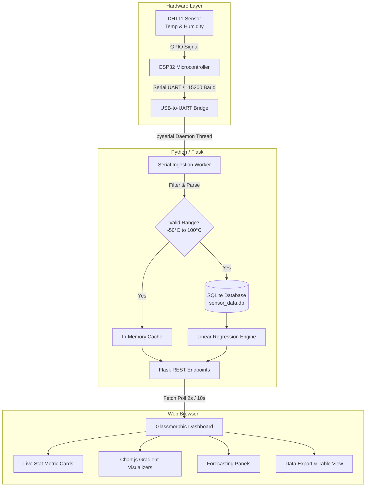

# 🌡️ ESP32 IoT Environmental Monitoring & Predictive Analytics Dashboard

[](https://python.org)
[](https://flask.palletsprojects.com/)
[](https://www.espressif.com/)
[](https://sqlite.org)
[](https://www.chartjs.org/)
[](LICENSE)

An intelligent, full-stack **IoT Environmental Monitoring Platform** powered by an **ESP32 microcontroller**, a **DHT11 digital sensor**, and a **Flask-based local edge dashboard**. 

The platform continuously samples ambient temperature and humidity, stores timestamped records into an on-premise SQLite database, renders real-time telemetry on a futuristic glassmorphic UI, and computes **short-term predictive trends using linear regression**.

---

## 📸 Project Gallery & Screenshots

> *Replace the image paths below with your actual project photos and screenshots in the repository.*

### 🖥️ Web Dashboard Interface
| Live Telemetry Monitor | Predictive Analytics & Historical Trends |
| :---: | :---: |
|  |  |
| *Real-time temperature, humidity & connection state* | *Linear regression forecast (+5m, +15m, +30m) & Chart.js graph* |

### 🔌 Hardware Circuit & Exhibition Setup
| ESP32 & DHT11 Circuit Setup | Exhibition Demonstration |
| :---: | :---: |
|  |  |
| *ESP32 connected via breadboard & USB serial* | *Live project demonstration at the IoT Exhibition* |

---

## 🌟 Key Features

- **⚡ Real-Time Sensor Telemetry**: Streams temperature (°C) and humidity (%) directly from the ESP32 over a robust USB-UART serial interface at 115200 baud.
- **📈 Short-Term Predictive Forecasting**: Runs an on-device Ordinary Least Squares (OLS) Linear Regression model over recent historical readings to forecast temperature for **+5 min**, **+15 min**, and **+30 min**, complete with trend indication (*Rising*, *Falling*, *Stable*) and Mean Absolute Error (MAE).
- **💾 Local Edge Data Persistence**: Automatically logs every valid telemetry record into an on-disk SQLite database (`sensor_data.db`) with zero external cloud dependencies or subscription costs.
- **🎨 Modern Glassmorphic Dark UI**: High-contrast, responsive interface built with vanilla HTML/CSS and Chart.js, featuring translucent glass cards, neon glow accents, animated status pulses, and mobile-friendly layouts.
- **📊 Interactive Data Visualization**: Dynamic, multi-gradient line charts for temperature and humidity history, updating asynchronously without requiring full page reloads.
- **📥 One-Click CSV Export**: Includes a streaming endpoint to download all stored historical readings in CSV format for spreadsheet auditing and data science workflows.
- **🛡️ Auto-Recovery & Reconnect**: Resilient serial polling thread with timeout detection, error boundaries, value validation filters, and live reconnection alerts.

---

## 🏛️ System Architecture



---

## 🔌 Hardware Setup & Pinout

### Components Required
- **ESP32 Development Board** (NodeMCU-32S / ESP32-WROOM-32)
- **DHT11 Temperature & Humidity Sensor** (3-pin or 4-pin module)
- **10kΩ Pull-Up Resistor** *(if using 4-pin standalone sensor)*
- **Breadboard and Jumper Wires**
- **Micro-USB / Type-C Cable** for PC serial communication

### Wiring Diagram
| DHT11 Pin | ESP32 Pin | Description |
| :--- | :--- | :--- |
| **VCC** | **3.3V / 5V** | Power Supply |
| **DATA / OUT** | **GPIO 4** *(or designated pin)* | Digital Sensor Signal |
| **GND** | **GND** | Common Ground |

### ESP32 Serial Protocol
The backend expects incoming newline-delimited strings formatted as:
```text
Temperature: 28.50 °C
Humidity: 65.00 %
```

---

## 💻 Tech Stack

### Hardware & Firmware
- **Platform**: ESP32 Microcontroller
- **Sensor**: DHT11 Digital Sensor
- **Firmware Framework**: Arduino C++
- **Communication Protocol**: UART Serial (115200 Baud)

### Backend & Analytics
- **Language**: Python 3.8+
- **Web Framework**: Flask
- **Serial Driver**: PySerial
- **Database**: SQLite3
- **Analytics**: Local Linear Regression (Time-series Ordinary Least Squares)

### Frontend & Styling
- **Markup & Layout**: Semantic HTML5 & Responsive Flexbox/Grid
- **Styling**: Vanilla CSS (Custom Glassmorphism Design System)
- **Typography**: Inter (Google Fonts)
- **Chart Engine**: Chart.js

---

## 📁 Repository Structure

```text
ESP32_IoT_Web_Dashboard/
├── app.py                  # Core Flask server, serial ingestion thread & predictive model
├── sensor_data.db          # Embedded SQLite database for historical sensor readings
├── .env.example            # Environment configuration template
├── README.md               # Comprehensive project documentation
├── templates/
│   └── index.html          # Single-Page Web Dashboard UI (Glassmorphic + Chart.js)
└── assets/                 # Project images, diagrams, and hardware photos
    ├── screenshots/        # Dashboard captures
    └── hardware/           # Circuit wiring and exhibition photos
```

---

## 🚀 Getting Started

### 1. Prerequisites
Ensure you have the following installed on your machine:
- **Python 3.8+**: [python.org](https://www.python.org/)
- **USB-UART Driver**: CP210x or CH340 driver (matching your ESP32 board)
- **Arduino IDE**: (if compiling/uploading firmware to the ESP32)

### 2. Clone the Repository
```bash
git clone https://github.com/Vishwajit-kamble/IOT-Project-Temperature-Sensor.git
cd IOT-Project-Temperature-Sensor
```

### 3. Create a Virtual Environment (Recommended)
```bash
# Windows
python -m venv venv
venv\Scripts\activate

# macOS / Linux
python3 -m venv venv
source venv/bin/activate
```

### 4. Install Dependencies
```bash
pip install flask pyserial python-dotenv
```

### 5. Configure Environment Variables
Copy `.env.example` to `.env` or set your COM port directly:
```env
SERIAL_PORT=COM13
BAUD_RATE=115200
```
> 💡 *Note: On Windows, verify your ESP32 COM port in **Device Manager** (e.g., `COM3`, `COM13`). On Linux/macOS, use `/dev/ttyUSB0` or `/dev/tty.usbserial-*`.*

### 6. Run the Application
Make sure the **Arduino Serial Monitor is closed**, then start the Python backend:
```bash
python app.py
```

### 7. Access the Dashboard
Open your web browser and navigate to:
```text
http://127.0.0.1:5000
```

---

## 📡 REST API Reference

| Endpoint | Method | Description | Sample Output |
| :--- | :--- | :--- | :--- |
| `/` | `GET` | Renders the web dashboard | HTML Page |
| `/api/current` | `GET` | Fetches latest sensor values, uptime, and status | `{"temperature": 27.8, "humidity": 58.0, "connected": true, ...}` |
| `/api/predictions` | `GET` | Calculates linear regression forecast (+5m, +15m, +30m) | `{"predictions": {"5m": 28.1, "15m": 28.6, "30m": 29.2}, "trend": "Rising", "metrics": {"mae": 0.32}}` |
| `/api/history?hours=1` | `GET` | Retrieves historical data points and statistical summary | `{"history": [...], "stats": {"temp_min": 24.1, "temp_max": 28.5, ...}}` |
| `/api/download_csv` | `GET` | Exports complete recorded sensor dataset as a CSV file | File stream (`sensor_data.csv`) |

---

## 👥 Project Team

This project was ideated, engineered, and demonstrated by:

| Member Name | Institutional Identifier | Primary Responsibilities |
| :--- | :--- | :--- |
| **Vishwajit Kamble** | Roll No. 28 | Backend Architecture, Serial Ingestion & API Development |
| **Ashish Naykudi** | Roll No. 44 | Hardware Prototyping, ESP32 Circuitry & Sensor Interfacing |
| **Sanskruti Neharkar** | Roll No. 45 | UI/UX Frontend Design, Analytics Visualization & Documentation |

---

## 🏆 Exhibition & Event Acknowledgements

This project was developed and officially showcased at the **R&D Club Inauguration & IoT Project Exhibition and Competition** on **10th October 2026**, organized by the **Department of Artificial Intelligence & Data Science (AI&DS)** at **Nutan Maharashtra Institute of Engineering and Technology (NMIET)**.

### Heartfelt Gratitude & Acknowledgements
- **Institute Management & Leadership**: Sincere gratitude to the NMVPM Management, the College Chairman, the Director, the Dean of Academics, the Controller of Examinations (Autonomy), and the Head of Department (AI&DS) for their visionary encouragement, institutional resources, and continuous patronage.
- **Distinguished Guests & Industry Evaluators**: Heartfelt thanks to our Esteemed Chief Guest (Software Developer – Cybersecurity, Reliance Jio, Mumbai) and Guests of Honour for reviewing the project, providing invaluable technical critiques, and inspiring practical industry alignment.
- **Faculty Coordinators & Mentors**: Warmest appreciation to the event faculty coordinators for their dedicated guidance, problem-solving mentorship, and logistical orchestration.
- **R&D Club Organizing Committee & Volunteers**: Kudos to the core student organizing teams—including Decoration, Anchoring, Invitation, and Exhibition Coordination committees—for delivering a premier technical symposium.

> *"Transforming Ideas into Innovation and Innovation into Impactful Solutions!"*

---

## 📄 License

This project is licensed under the [MIT License](LICENSE) — free for educational and research use.
